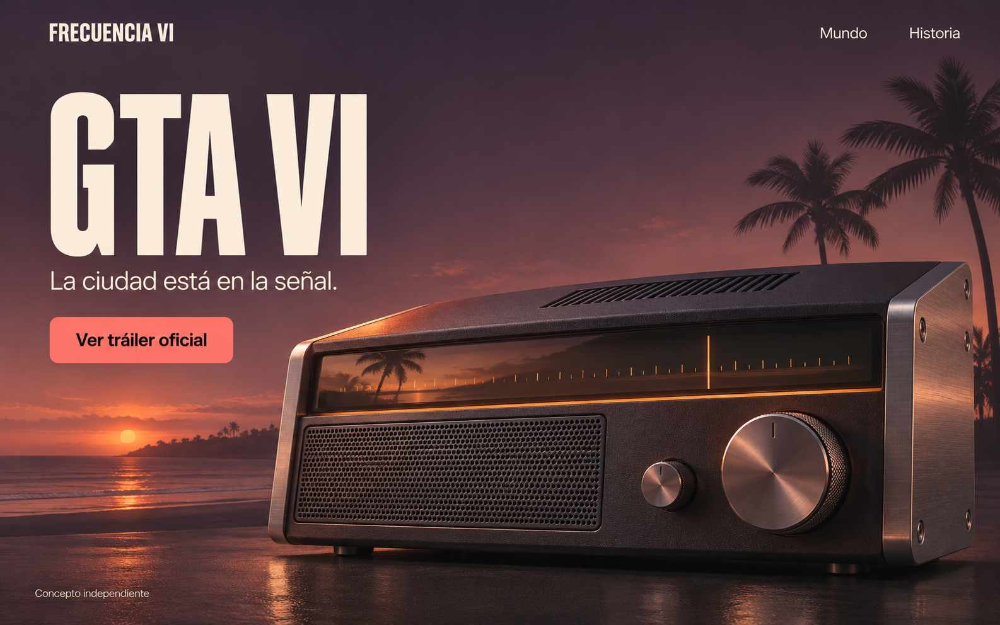
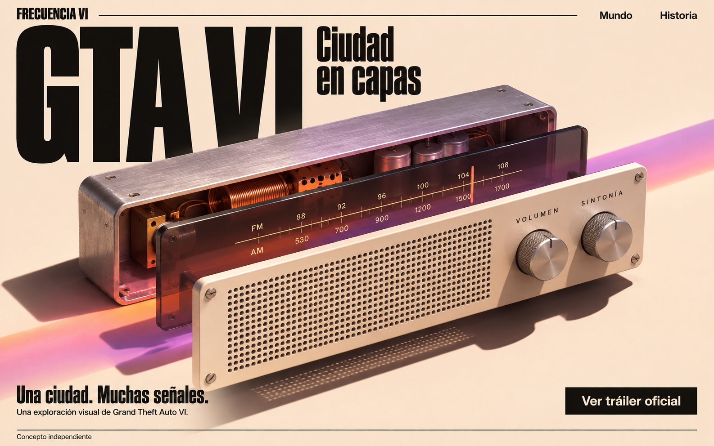
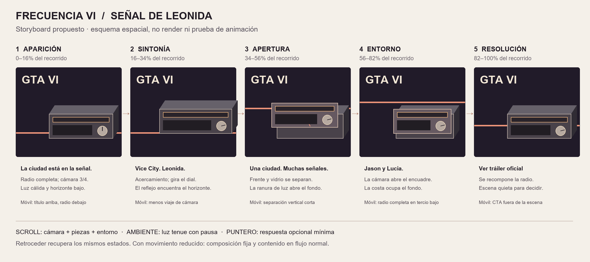

> Registro histórico anterior a la elección de variante 1. Consultar [estado vigente](README.md).

# Frecuencia VI — UX/UI y movimiento

Fecha: 2026-11-05, America/Buenos_Aires.

**Dirección elegida por el usuario: Frecuencia VI. Variante visual pendiente de elección. Implementación no autorizada en esta etapa.**

1. [Propuesta de UX/UI y dos variantes](UX-UI.md)
2. [Storyboard de cinco momentos y especificación de movimiento](STORYBOARD.md)
3. [Evidencia temporal, mediciones y fuentes públicas](EVIDENCIA-MOVIMIENTO.md)
4. [Prueba representativa y recursos pendientes](PRUEBA-Y-RECURSOS.md)
5. [Revisión de calidad](REVISION.md)
6. [Prompts y procedencia de imágenes conceptuales](PROMPTS.md)

## Apariencia propuesta

Las dos imágenes siguientes son conceptos estáticos generados con la herramienta integrada. No son modelos 3D finales, capturas de una aplicación ni pruebas de animación. Se solicita elegir una variante, no aprobar automáticamente una implementación.

### Variante 1 — Señal de Leonida, recomendada

### Variante 2 — Ciudad en capas

## Esquema de coreografía

Este es un diagrama de especificación, no una demostración de movimiento.

La investigación anterior se conserva en `../investigacion/` como antecedente. La idea inicial de radio pequeña queda superada por el pedido actual de una radio protagonista con presencia física y coreografía elaborada.
