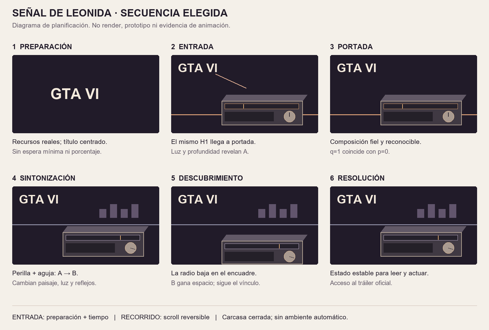

# Frecuencia VI — Señal de Leonida

2026-11-05. **Variante 1 elegida por el usuario.** Estado actual: diagnóstico de RAM y especificación de seis momentos, con entrada tipográfica ligada a preparación y sintonización reversible del entorno. Implementación pendiente de la siguiente indicación del usuario.

- [Resultado del diagnóstico de RAM](DIAGNOSTICO-RAM.md)
- [UX/UI vigente y estados de carga](UX-UI-V2.md)
- [Storyboard de seis momentos y conexión de controles](STORYBOARD-V2.md)
- [Plan de prueba pequeña y recursos pendientes](PRUEBA-Y-RECURSOS-V2.md)
- [Revisión de especificación](REVISION-V2.md)
- [Evidencia de referencias ya completada](EVIDENCIA-MOVIMIENTO.md)

## Referencia de apariencia aprobada

[Variante 1 — Señal de Leonida](visuales/variante-1-senal-de-leonida.png). Se conserva el archivo original: radio oscura protagonista, materiales y reflejos cálidos, playa al atardecer y título arriba a la izquierda. El mockup no se utilizará completo como fondo para simular una radio 3D.

## Secuencia vigente

1. Preparación real y GTA VI centrado.
2. Mismo título hacia portada y revelación coordinada de una escena completa.
3. Portada estable, sin espera artificial.
4. Perilla y aguja sintonizan entre dos ambientes con profundidad, luz y reflejos.
5. Radio baja en el encuadre y descubre el otro fondo.
6. Resolución estable con contenido y tráiler.

La apertura de carcasa queda fuera del núcleo y de la prueba mínima. No se generaron imágenes conceptuales nuevas, modelos, videos finales, prototipos ni código de aplicación.

## Antecedentes conservados

[Entrega de UX/UI anterior](README-ETAPA-UX-INICIAL.md), [prompts de ambos conceptos](PROMPTS.md), [storyboard anterior](STORYBOARD.md), [estudio general](../investigacion/PROPUESTAS.md). La variante 2 y la apertura protagonista de esos documentos son antecedentes, no decisiones vigentes.
